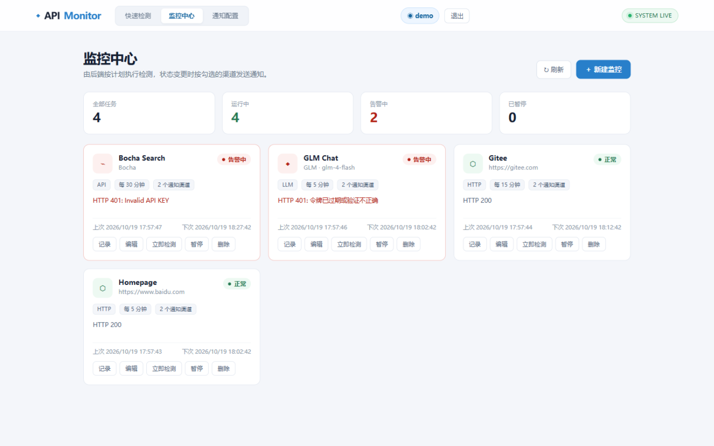
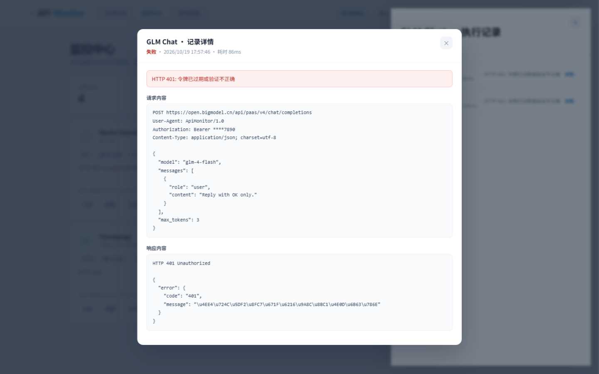
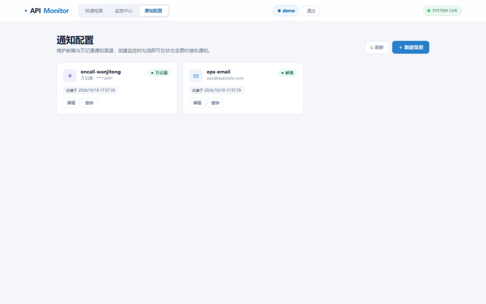
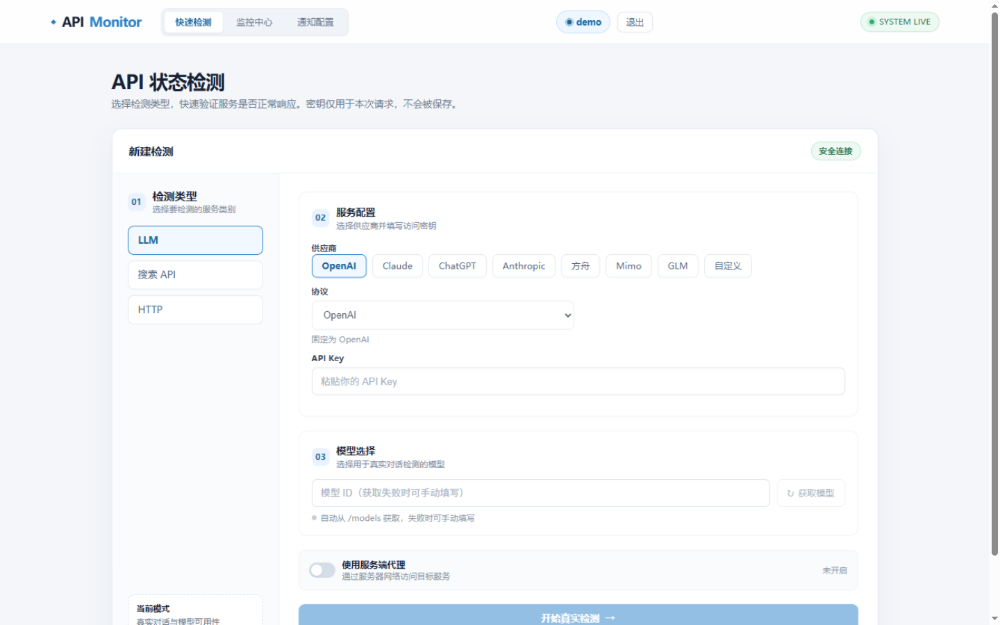
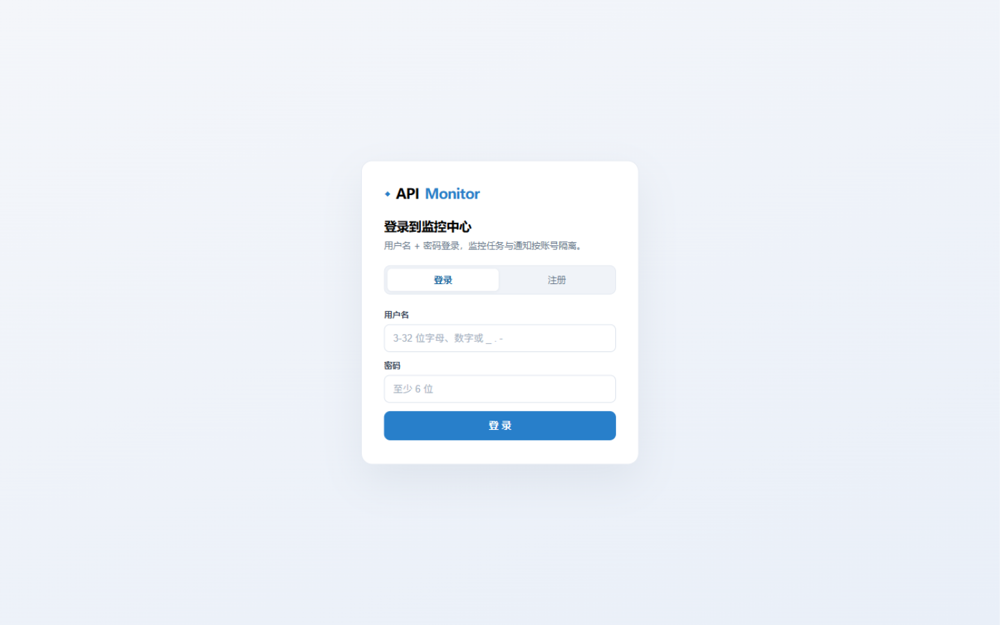

<p align="center">
  
</p>

<h4 align="center">自部署的 API 监控平台 —— 定时检测 LLM / 搜索 API / HTTP / 代理 / 数据库，状态变更即刻通知</h4>

<p align="center">
  
  
  
  
  
</p>

---

## 📸 界面预览

**监控中心** —— 任务状态一览，异常告警实时可见：



<table>
  <tr>
    <td width="50%" align="center"><b>执行记录详情</b> —— 点开任意记录<br>查看完整请求与响应（密钥自动脱敏）</td>
    <td width="50%" align="center"><b>通知配置</b> —— 集中管理渠道<br>任务中勾选即启用</td>
  </tr>
  <tr>
    <td></td>
    <td></td>
  </tr>
  <tr>
    <td align="center"><b>快速检测</b> —— 免登录即测即走</td>
    <td align="center"><b>登录 / 注册</b> —— 多用户数据隔离</td>
  </tr>
  <tr>
    <td></td>
    <td></td>
  </tr>
</table>

## ✨ 功能特性

| | 特性 | 说明 |
| --- | --- | :--- |
| 🔍 | **五类检测** | LLM 真实对话 · 搜索 API · HTTP 探活 · 代理链路（TCP/UDP）· 数据库连通性 |
| 🤖 | **LLM 供应商** | OpenAI、Claude、ChatGPT、Anthropic、方舟、Mimo、GLM、自定义端点（OpenAI / Anthropic 协议兼容） |
| 🔎 | **搜索供应商** | Bocha、Tavily、Brave、百度千帆、Serper、Exa |
| 🗄️ | **数据库** | MySQL（含 OceanBase / Manticore）、TDengine、Milvus、TuGraph |
| ⏰ | **定时调度** | 1 分钟 ~ 1 天间隔，后台自动执行，失败告警 / 恢复通知 |
| 📜 | **记录详情** | 每次执行保存完整请求与响应内容，密钥脱敏展示 |
| 📣 | **状态翻转通知** | 正常→异常、异常→正常才通知，持续失败不打扰；邮箱 + 万记通双渠道按用户管理、任务勾选启用 |
| 👥 | **多用户** | 用户名密码注册登录，监控任务 / 通知渠道按账号隔离 |
| 🔐 | **凭据安全** | API Key / 数据库密码 AES-GCM 加密入库，密码 PBKDF2 散列 |
| 🗃️ | **双数据库** | SQLite 开箱即用，MySQL（自动建库）企业部署 |

## 🚀 快速开始

环境要求：.NET 9 SDK、Node.js 18+

```bash
# 1. 后端
cd ApiMonitor.Api
cp appsettings.example.json appsettings.json   # 按需修改
dotnet run                                     # http://localhost:5240

# 2. 前端（开发模式）
cd web
npm install
npm run dev                                    # http://localhost:5173，/api 自动代理
```

首次启动自动创建默认管理员 **`admin` / `admin123`**，请妥善保管。快速检测页无需登录。

## 🐳 Docker 部署（推荐）

```bash
git clone https://github.com/lld1995/API-Monitor.git && cd API-Monitor
bash run.sh            # 默认 5240 端口；自定义端口：bash run.sh 8080
```

- 多阶段构建（Node 编译前端 → .NET 发布 → aspnet 运行时），单容器同时提供页面与 API
- 数据持久化在宿主机 `/root/api-monitor-data/`：配置、SQLite 数据库、Cookie 加密密钥
- 首次运行自动生成 `appsettings.json`（加密密钥随机化，后续勿改）
- `--restart unless-stopped` 常驻运行；更新版本：同步代码后再执行 `bash run.sh`，数据保留

## ⚙️ 配置说明

<details>
<summary><b>appsettings.json 全部配置项</b>（点击展开）</summary>

| 配置节 | 必填 | 说明 |
| --- | --- | --- |
| `ConnectionStrings:Default` | 是 | SQLite：`Data Source=api-monitor.db`；MySQL：`Server=...;Port=3306;User ID=...;Password=...;Database=api_monitor` |
| `Database:Provider` | 否 | `sqlite`（默认）或 `mysql`，MySQL 下目标库不存在会自动创建 |
| `Security:KeyEncryptionSecret` | 是 | 凭据加密密钥，长随机串；生产环境建议环境变量 `Security__KeyEncryptionSecret` 注入 |
| `Smtp:*` | 邮箱通知需要 | 发件账号：`Host` / `Port`(587) / `EnableSsl` / `From` / `Username` / `Password`(SMTP 授权码) |
| `Wanjitong:Endpoint` | 否 | 万记通端点，默认 `https://www.wanjitong.cn/api/memos` |
| `Proxy:Url` | 否 | 「使用服务端代理」开关所用的出站代理 |

> 邮箱通知：端口用 **587（STARTTLS）**，.NET SmtpClient 不支持 465 隐式 SSL；QQ / 163 需先生成 SMTP 授权码。
> 万记通通知：在 [wanjitong.cn](https://www.wanjitong.cn) 生成 API Key 添加为渠道即可，无需服务端配置。

</details>

<details>
<summary><b>非 Docker 生产部署</b>（点击展开）</summary>

```bash
cd web && npm run build                          # 产物自动输出到 ApiMonitor.Api/wwwroot
cd ../ApiMonitor.Api && dotnet publish -c Release -o publish
cd publish && dotnet ApiMonitor.Api.dll          # 单服务提供页面 + API
```

</details>

## 🔒 安全设计

- 用户密码 PBKDF2-SHA256（10 万次迭代 + 随机盐）
- API Key / 数据库密码 / 代理密码 / 万记通 Key 全部 AES-GCM 加密存储
- 执行记录中的请求头与请求体自动脱敏（密钥仅显示末 4 位）
- 快速检测密钥不落库；公开检测接口限流 5 次/分钟，登录注册限流 20 次/分钟

## 📡 API 概览

<details>
<summary><b>主要接口</b>（点击展开）</summary>

| 路由 | 说明 |
| --- | --- |
| `POST /api/auth/{login,register,logout}` · `GET /api/auth/me` | 用户认证（Cookie 会话） |
| `GET/POST/PUT/DELETE /api/monitoring[/{id}]` | 监控任务 CRUD（按用户隔离） |
| `POST /api/monitoring/{id}/run` · `GET /{id}/runs` · `GET /runs/{runId}` | 手动执行 / 记录列表 / 记录详情 |
| `GET/POST/PUT/DELETE /api/notifications[/{id}]` | 通知渠道 CRUD |
| `POST /api/public-check` · `/api/http-check` · `/api/models` | 快速检测（免登录，限流） |

</details>

---

<p align="center"><sub>Built with .NET 9 + Vue 3 · 监控 · 通知 · 一处掌控</sub></p>
